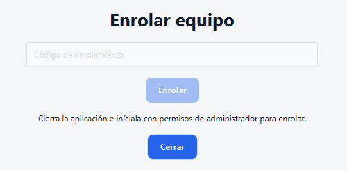

# Insumos de Desktop para el manual de TI (DSK-16)

Pasos y mensajes contrastados con el código, las pruebas existentes y la documentación del
instalador. Los insumos son para que el Scrum Master redacte el manual; no sustituyen la guía de
instalación de producción.

## 1. Instalar el escritorio

1. Descarga el `.msi` y el archivo `.sha256` del mismo release oficial.
2. En PowerShell, calcula el hash del archivo descargado:

   ```powershell
   Get-FileHash .\internet-cafe-desktop-v1.0.0.msi -Algorithm SHA256
   ```

3. Si el release tiene otra versión, sustituye el nombre por el nombre exacto del `.msi`
   descargado. Compara el valor `Hash` con el contenido del `.sha256`. No instales si no coincide.
4. Abre el `.msi` verificado y sigue las pantallas del instalador de Windows. Conserva la carpeta
   de instalación predeterminada: el script de arranque busca el ejecutable en
   `%ProgramFiles%\Internet Cafe Desktop\Internet Cafe Desktop.exe`. El instalador crea el acceso
   del menú Inicio y un acceso directo. Si cambias la carpeta, el script no encontrará el programa.

El `.msi` aún no tiene firma Authenticode. SmartScreen puede advertirlo; solo continúa con un
instalador del release oficial cuyo SHA-256 ya verificaste; en SmartScreen selecciona «Más
información» → «Ejecutar de todas formas». El `.msi` fija la URL de API del
entorno donde se construyó. La URL también se puede cambiar al registrar el arranque (sección 4).

## 2. Enrolar un equipo

El enrolamiento requiere conexión con la API, permisos de administrador de Windows y un código
de un solo uso, vigente por 24 horas, generado para ese equipo desde el panel de administración.
Usa la misma cuenta de Windows para enrolar y ejecutar después el escritorio: la identidad y los
datos de enrolamiento se protegen con DPAPI para el usuario actual.

1. Abre PowerShell y ejecuta el escritorio elevado, usando la ruta instalada:

   ```powershell
   Start-Process -FilePath "$env:ProgramFiles\Internet Cafe Desktop\Internet Cafe Desktop.exe" -ArgumentList '--enroll' -Verb RunAs -Wait
   ```

2. Acepta UAC para **la misma cuenta de Windows** que usará el equipo. Si UAC solicita las
   credenciales de otra cuenta, cancela y consulta a TI; el enrolamiento se protege para el
   usuario actual.
3. En «Enrolar equipo», ingresa el código de un solo uso entregado por TI y selecciona «Enrolar».
4. Cuando aparezca «Equipo enrolado. La credencial se guardó de forma segura.», cierra la ventana.

El código no se debe reutilizar ni incluir en capturas. La aplicación guarda la identidad y la
credencial de forma protegida; no las muestra ni las registra en logs. Si el resultado informa
«El servidor aceptó el equipo, pero no se pudo verificar o guardar el resultado. Contacta a TI
antes de reintentar.», consulta a TI antes de solicitar otro código.

Captura real de la pantalla de desarrollo cuando el escritorio no se ejecuta como administrador
(el campo está vacío; no es una confirmación de enrolamiento):



## 3. Cambio de modo

El modo se asigna al equipo desde el panel de administración; no requiere reinstalar el `.msi`.
El escritorio consulta el cambio en el próximo latido, cada 60 segundos, con hasta 5 segundos de
timeout. Espera hasta 65 segundos para que se aplique.

| Modo | Comportamiento |
|---|---|
| Kiosco | La ventana se mantiene a pantalla completa y bloqueada mientras no haya una sesión activa ni esté activo el fail-open. |
| Pasivo | Se pausa la generación del QR y la ventana se puede minimizar a la bandeja. «Registrar acceso» desde la bandeja vuelve al QR. |

Una sesión activa libera temporalmente el kiosco. Cuando termina, la ventana vuelve a bloquearse
si el equipo sigue en modo kiosco.

## 4. Arranque al iniciar sesión

El instalador no registra el inicio automático ni instala los scripts. TI debe obtener
`Register-Startup.ps1` y `Remove-Startup.ps1` del directorio `desktop/packaging` del repositorio
y ejecutar PowerShell como administrador.

Desde el directorio que contiene los scripts:

```powershell
.\Register-Startup.ps1
```

El script crea o reemplaza la tarea programada **Internet Cafe Desktop**, que inicia el programa
cuando inicia sesión la cuenta indicada. Por defecto usa la cuenta actual (`USERDOMAIN\USERNAME`)
y la URL de API que quedó configurada en el `.msi`. La tarea usa el token interactivo de esa
cuenta y no almacena su contraseña.

Para seleccionar otra cuenta o sobreescribir la URL de API:

```powershell
.\Register-Startup.ps1 -UserAccount ".\cuenta-de-equipo" -ApiBaseUrl "https://api.ejemplo.invalid"
```

Reemplaza la cuenta y la URL de ejemplo por valores aprobados para el entorno. La URL debe ser
el origen de la API, sin barra final. La tarea usa el nivel `HIGHEST`; confirma
que la cuenta configurada sea la cuenta de Windows que debe abrir la aplicación. La tarea inicia
la aplicación al iniciar sesión: no es un servicio ni vuelve a abrirla si alguien la cierra.

Para quitar el inicio automático:

```powershell
.\Remove-Startup.ps1
```

Ambos scripts requieren elevación. Si `Register-Startup.ps1` indica que no encontró el ejecutable,
instala primero el `.msi`. Si ya existe la tarea, el registro la reemplaza con la configuración
nueva.

## 5. Kiosco y limitaciones

En modo kiosco, el escritorio ocupa toda la pantalla, se mantiene encima de otras ventanas y
revierte los intentos de cerrarlo o minimizarlo. Si la API deja de responder, después de tres
minutos sin conexión activa el fail-open y libera el equipo; al restablecerse la conexión, vuelve
a bloquearlo si no hay una sesión activa.

**No es un bloqueo de seguridad de Windows.** La aplicación no intercepta ni bloquea
`Alt+Tab`, la tecla Windows ni `Ctrl+Alt+Supr`; esos atajos y el cambio a otras aplicaciones
siguen disponibles. Esta limitación está aceptada para el MVP. El personal del local conserva el
control físico del equipo.

## 6. Solución de problemas

| Situación o mensaje | Qué comprobar / hacer |
|---|---|
| SmartScreen advierte sobre el instalador | Confirma que el `.msi` provenga del release oficial y vuelve a comprobar el SHA-256. El instalador no está firmado con Authenticode. |
| «Cierra la aplicación e iníciala con permisos de administrador para enrolar.» | Cierra el escritorio y vuelve a iniciarlo con `--enroll` elevado, usando la misma cuenta de Windows. |
| «El código no es válido, ya se usó o venció.» | Pide al administrador un código nuevo; el código es de un solo uso y vence a las 24 horas. |
| «La clave de este equipo ya está registrada.» | No sigas reintentando; contacta a TI para revisar la identidad enrolada. |
| «Se alcanzó el límite de intentos. Espera antes de volver a intentarlo.» | Espera y solicita ayuda al administrador si vuelve a ocurrir. |
| «Equipo no disponible» / «No se enviará peticiones del equipo. Verifica el enrolamiento o contacta a TI.» | Comprueba que se completó el enrolamiento con la misma cuenta de Windows. Si el problema continúa, contacta a TI. |
| «Modo fail-open activo» | La API no respondió durante tres minutos y el kiosco se liberó. Comprueba la red; el bloqueo se restablece al recuperar la conexión, si no hay una sesión activa. |
| El cambio de modo no aparece de inmediato | Espera hasta 65 segundos por el siguiente latido. No reinstales el escritorio. |
| El script de arranque no encuentra la aplicación | Verifica que el `.msi` esté instalado y que exista `%ProgramFiles%\Internet Cafe Desktop\Internet Cafe Desktop.exe`. |
| `schtasks` devuelve error al registrar o quitar la tarea | Ejecuta PowerShell como administrador y revisa que la cuenta indicada exista y pueda iniciar sesión en Windows. |

## 7. Capturas para completar en el entorno dev

Se incluye una captura real y no sensible de la pantalla de enrolamiento sin privilegios elevados.
Se generó, verificó, instaló y desinstaló un `.msi` local de desarrollo; también se probó el
registro de la tarea de arranque con la aplicación instalada y luego se retiró. Estas pruebas no
usaron un instalador de release ni se capturó el asistente de Windows. No se ingresó un código de
enrolamiento. Tampoco se capturaron un enrolamiento exitoso, un cambio de modo, el kiosco/fail-open
ni la tarea en el Programador de tareas. Las imágenes de `docs/mockups/` son mockups, no capturas
del producto y no se presentan como evidencia.

Al completar la documentación en un entorno dev autorizado, agregar imágenes reales y no sensibles
de:

1. Instalador de Windows y aplicación instalada, sin rutas ni nombres de usuario personales.
2. Confirmación de enrolamiento exitoso, ocultando el código, el código del equipo, el identificador
   de clave y cualquier credencial.
3. Cambio de modo en el panel y comportamiento resultante del escritorio.
4. Ventana en kiosco y aviso de fail-open, sin QR ni datos de sesiones.
5. Tarea **Internet Cafe Desktop** en el Programador de tareas, ocultando la cuenta de Windows.

No incluir códigos de enrolamiento, QR, credenciales, correos, nombres reales ni identificadores
de equipos o sesiones.
